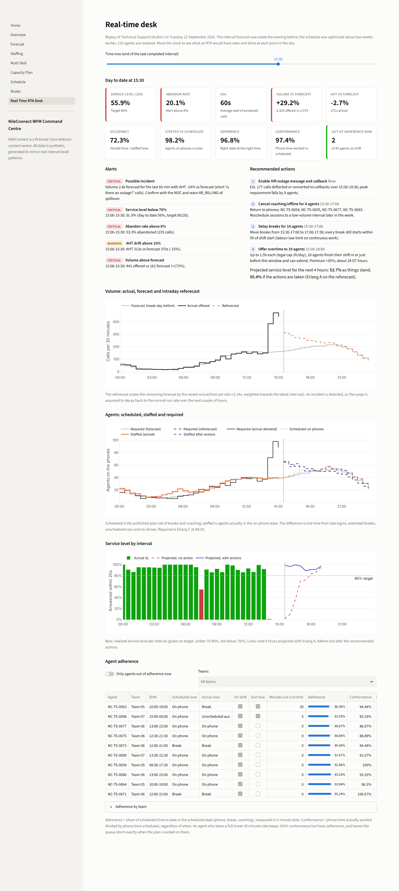
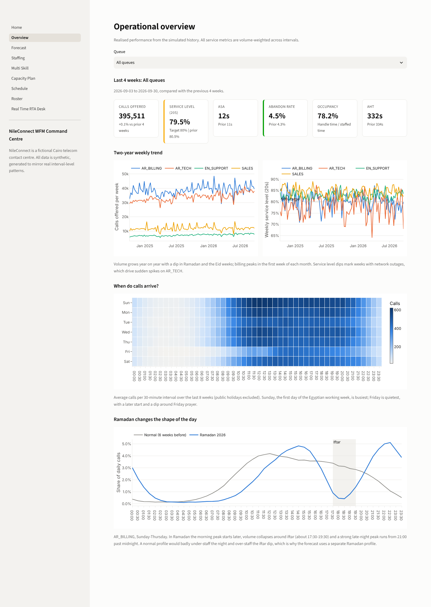
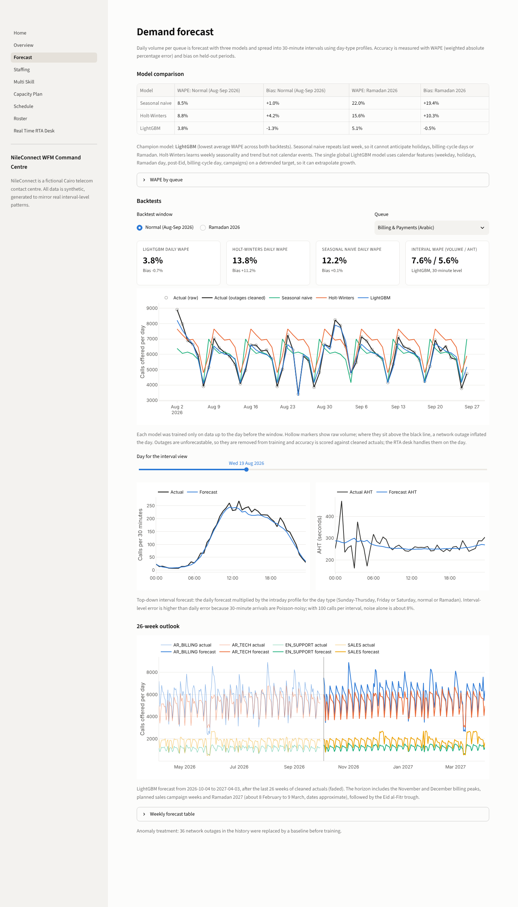
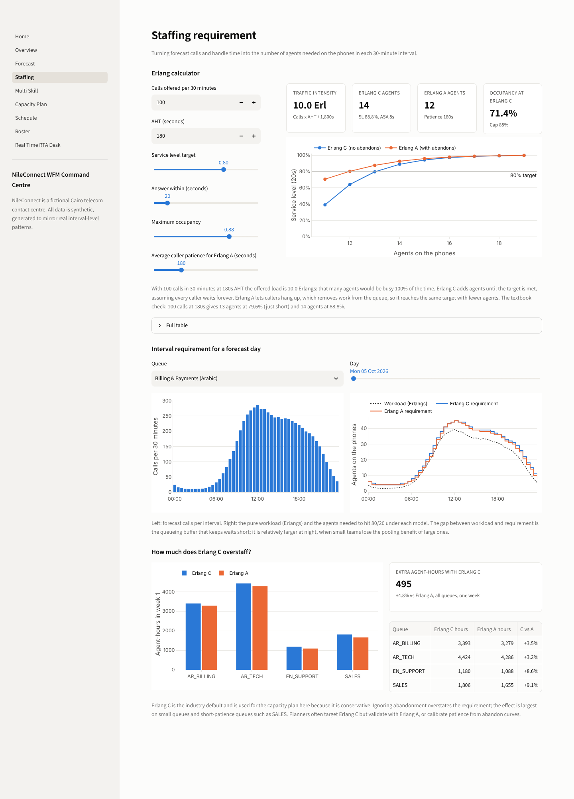
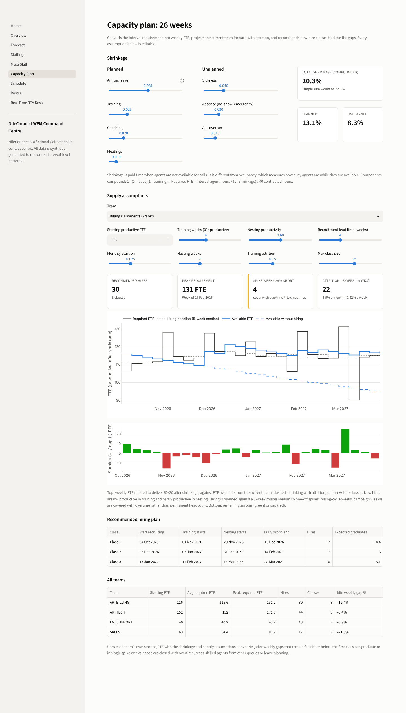
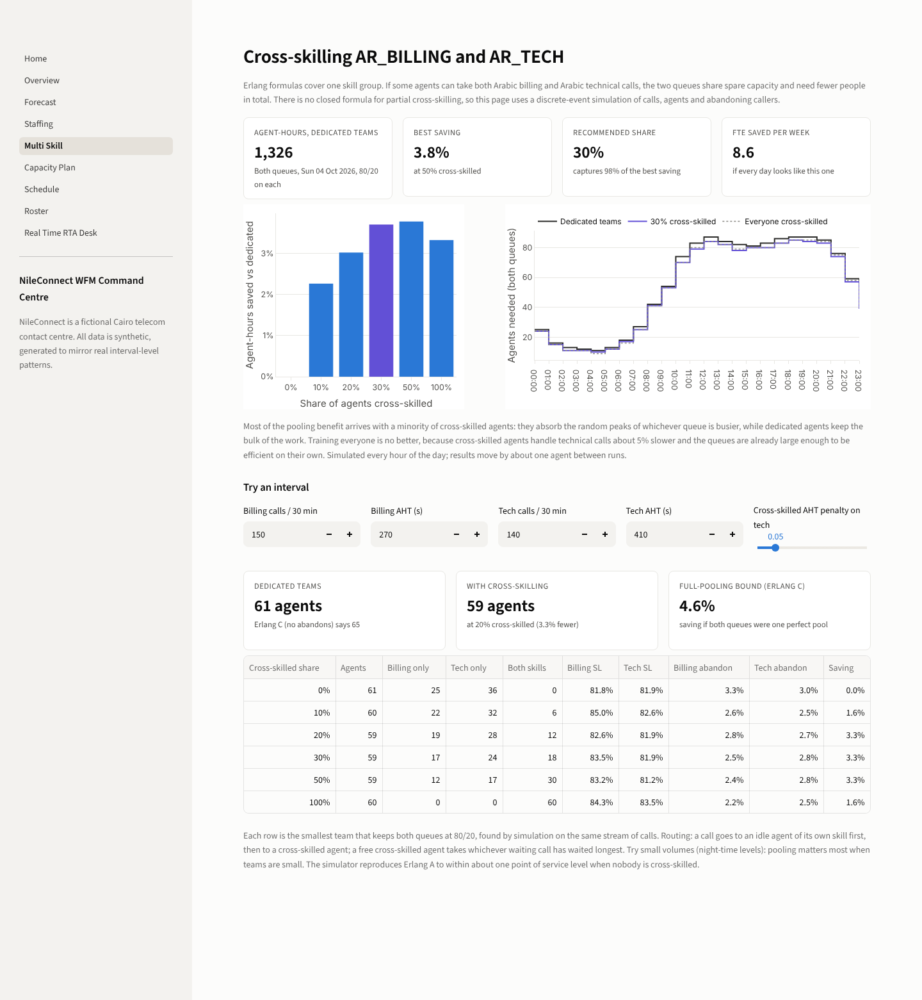
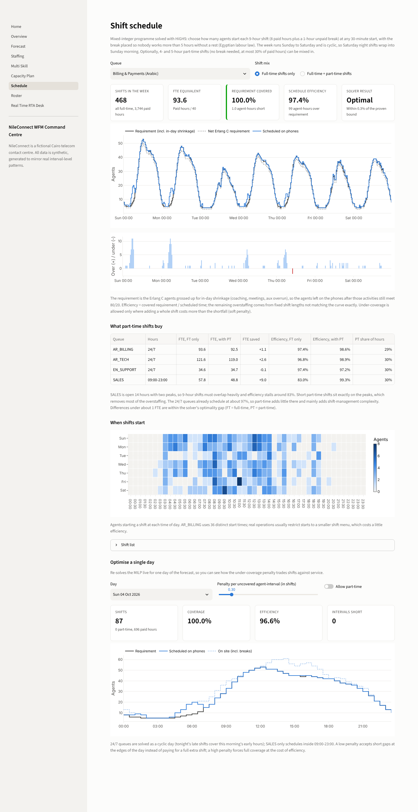
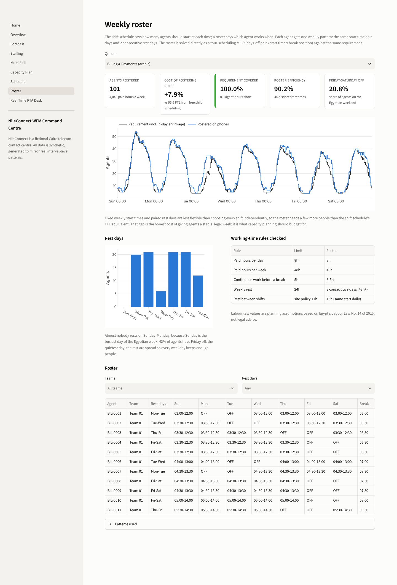
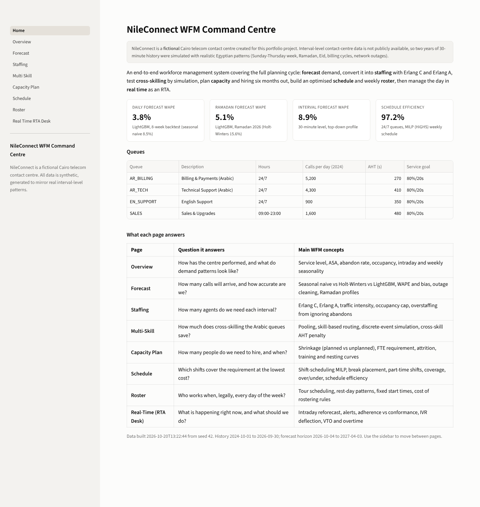

# WFM Command Center: NileConnect

A complete workforce management system for **NileConnect**, a fictional Cairo telecom contact centre: demand forecasting, Erlang C / Erlang A staffing, a cross-skilling simulation, 26-week capacity and hiring plan, MILP shift scheduling with part-time shifts, weekly rostering and a real-time analyst (RTA) desk, delivered as an eight-page Streamlit app.

**[Open the live demo](https://wfm-command-center-k7x5ugtdxsjssrxzgs27vt.streamlit.app/)** (Streamlit Community Cloud). The Real-Time page replays an outage day; drag the clock to 14:30 to see the incident detected.

> **NileConnect is fictional and all data is synthetic.** Real interval-level contact-centre data is not publicly available, so two years of 30-minute history were simulated with realistic Egyptian patterns (see [Data](#data)). Every number below comes from that simulated operation.



---

## The business problem

NileConnect runs four queues out of Cairo, about 13,000 calls a day:

| Queue | Description | Hours | Calls/day | AHT |
|---|---|---|---|---|
| AR_BILLING | Billing & Payments (Arabic) | 24/7 | ~5,200 | ~270s |
| AR_TECH | Technical Support (Arabic) | 24/7 | ~4,300 | ~410s |
| EN_SUPPORT | English Support | 24/7 | ~900 | ~350s |
| SALES | Sales & Upgrades | 09:00-23:00 | ~1,600 | ~480s |

The service goal is **80% of calls answered within 20 seconds** with occupancy capped at 88%. The operation has to plan around things a generic WFM template ignores:

- **An Egyptian working week:** Sunday is the busiest day, Friday the quietest and Saturday a reduced day.
- **Ramadan:** the whole shape of the day changes. The morning peak starts later, volume collapses at iftar and a large late-night peak runs past midnight.
- **Eid and national holidays:** volume troughs, followed by a bounce-back the day after Eid.
- **Billing cycles:** spikes on days 1-5 of every month.
- **Unplanned network outages:** these triple technical-support volume within 30 minutes.
- **Typical BPO attrition** of about 3.5% a month, with a four-week training pipeline.
- **Egyptian labour law** (Law 14 of 2025): 8 paid hours a day, no more than 5 hours of continuous work, 24 hours of weekly rest and a 2-hour daily overtime cap.

## Approach

The project follows the planning cycle a WFM team runs, from long range to intraday:

```
Simulated history ──> Forecast ──> Staffing ──> Capacity plan ──> Schedule ──> Roster ──> Real-time desk
 (2 years, 30-min)    (3 models,   (Erlang C/A,  (shrinkage,      (MILP,       (tours:    (reforecast,
                       backtests)   cross-skill   attrition,       part-time    5 days,    alerts, actions,
                                    simulation)   hiring)          option)      2 off)     adherence)
```

1. **Forecast.** Daily volume per queue from three models: seasonal naive, Holt-Winters, and one global LightGBM model on calendar features with a detrended target. Outage days are cleaned before training. The daily forecast is spread to 30-minute intervals using day-type profiles (Sunday-Thursday / Friday / Saturday × normal / Ramadan), with the Ramadan profile learned from the previous Ramadan. AHT is forecast per interval.
2. **Staffing.** Vectorised Erlang C converts each interval's calls and AHT into agents for 80/20. Erlang A (with caller patience) is computed alongside to show how much Erlang C overstaffs. A discrete-event simulation of the two Arabic queues tests how many agents cross-skilling would save, something no Erlang formula can answer.
3. **Capacity.** Interval agent-hours, compounded shrinkage and 40 contracted hours give weekly FTE. Supply is projected with attrition, training (0% productive) and nesting (60%), and new-hire classes are recommended.
4. **Schedule.** A mixed-integer programme (scipy `milp` / HiGHS) chooses shift starts and break positions for a cyclic Sunday-Saturday week, with breaks placed to respect the 5-hour rule. Optionally it mixes in 4- and 5-hour part-time shifts, capped at 30% of paid hours.
5. **Roster.** A second MILP (tour scheduling) gives every agent a legal weekly pattern: the same start time on 5 days and 2 consecutive rest days. It produces a named roster, team by team.
6. **Real time.** A replay of a real day on AR_TECH with an afternoon outage. It uses the forecast made the evening before, the optimised schedule and 129 simulated agents with late logins, extended breaks, aux and no-shows. The desk reforecasts the rest of the day, raises alerts and recommends actions with numbers and times.

## Results

### Forecast accuracy (daily WAPE, lower is better)

Each model was trained only on data up to the day before the window. Accuracy is scored against outage-cleaned actuals.

| Model | Normal: Aug-Sep 2026 (8 weeks) | Ramadan 2026 (7 weeks incl. Eid) |
|---|---|---|
| Seasonal naive | 8.5% | 22.0% |
| Holt-Winters | 8.8% | 15.6% |
| **LightGBM (champion)** | **3.8%** | **5.1%** |

- **LightGBM is 55% more accurate than seasonal naive** in a normal period and **77% more accurate through Ramadan.** Its bias is under 1.5% in both windows (-1.3% normal, -0.5% Ramadan), against +19.4% for seasonal naive in Ramadan.
- **Ramadan is handled.** The only Ramadan in the training data is Ramadan 2025, yet LightGBM's Ramadan WAPE (5.1%) is close to its normal-period WAPE. Holt-Winters is thrown off by the Eid trough. Seasonal naive fails badly on SALES (50% WAPE) because the week before the window was a campaign week.
- **Interval level (30 minutes):** volume WAPE is 8.9% in the normal window and 10.3% in Ramadan, and AHT WAPE is 6.9% and 7.2%. Much of the interval error is irreducible Poisson noise: at 100 calls an interval, randomness alone is about 8%.

### Staffing: Erlang C vs Erlang A

- **Textbook check:** 100 calls in 30 minutes at 180s AHT is 10 Erlangs. Erlang C says 13 agents give 79.6% (just short) and **14 agents give 88.8%** at 7.8s ASA and 71% occupancy. With 180s average patience, Erlang A needs **12 agents**.
- Across the first forecast week, **Erlang C asks for 495 more agent-hours than Erlang A (+4.8%).** The gap is +3% on the large Arabic queues and +9% on EN_SUPPORT and SALES: small queues and impatient callers are where ignoring abandonment costs the most.

### Cross-skilling AR_BILLING and AR_TECH (simulation)

A discrete-event simulation reproduces Erlang A to within about 1 point of service level when nobody is cross-skilled. Simulating a full Sunday with both queues held at 80/20:

| Share of agents cross-skilled | 0% | 10% | 20% | **30%** | 50% | 100% |
|---|---|---|---|---|---|---|
| Agent-hours saved | – | 2.3% | 3.0% | **3.7%** | 3.8% | 3.3% |

- **Cross-skilling 30% of agents captures 98% of the best saving,** about 8.6 FTE a week.
- **Training everyone is worse than training 30%,** because cross-skilled agents handle technical calls about 5% slower. Large queues are already efficient on their own, so the gain is modest.

### Capacity plan (October 2026 to March 2027)

- **Requirement:** an average of **372 FTE**, peaking at **408 FTE** in the first week of Ramadan 2027 (28 February). Default shrinkage is **20.3% compounded** (22.1% if simply added).
- **Recommended hiring: 104 hires in 10 classes across the four teams.** For example, AR_TECH needs classes of 21, 17 and 6 starting 1 November, 13 December and 3 January to be proficient before the Ramadan peak, when it needs 172 FTE.
- **Hires are planned against a 5-week rolling median of the requirement,** so one-off billing-cycle and campaign weeks are covered with overtime instead of permanent headcount that would sit idle afterwards.

### Schedule and roster (week of 4 October 2026)

| Queue | FTE, full-time shifts | Efficiency | FTE, with part-time | Efficiency | Rostered agents |
|---|---|---|---|---|---|
| AR_BILLING | 93.6 | 97.4% | 92.5 | 98.6% | 101 |
| AR_TECH | 121.6 | 96.8% | 119.0 | 98.9% | 126 |
| EN_SUPPORT | 34.6 | 97.4% | 34.7 | 97.2% | 36 |
| SALES | 57.8 | 83.0% | **48.8** | **99.3%** | 59 |

- **The 24/7 queues are scheduled at about 97% efficiency with full-time shifts alone,** each within 2.5% of HiGHS's proven optimum.
- **SALES is open only 14 hours a day with two peaks,** so 9-hour shifts cannot follow it. **Adding 4- and 5-hour part-time shifts cuts SALES by 9 FTE (-16%) and lifts its efficiency from 83% to 99%.** On the 24/7 queues, part-time gains are within the solver gap.
- **Legal weekly rosters cost 2-8% more heads than free shift scheduling.** Every agent works 5 days at the same start time with 2 consecutive rest days, and that stability has a price. Rest days avoid Sunday, the busiest day, and 40-50% of agents get Friday off.

### Real-time desk: the 22 September 2026 outage

At 14:00 AR_TECH volume jumps to 2.5x forecast. The desk flags a **possible incident at 14:30**, 30 minutes in, based on volume at 2.5x forecast and AHT 21% below forecast (short "is there an outage?" calls). By 15:30 the day-to-date service level has fallen to 56%, with 20% abandoned. The engine recommends, in order of cost:

1. **Enable the IVR outage message and callback:** about 177 calls deflected over the next 4 hours, cutting peak requirement by 9 agents.
2. **Cancel coaching for 4 named agents** between 15:30 and 17:00.
3. **Delay breaks for 18 agents** from 15:30-17:00 to 17:00-17:30. Every break still starts within 5 hours of the shift start.
4. **Offer overtime to 19 agents** from 15:30 to 18:00, at most 1.5 hours each, at a +35% premium (about 28 overtime hours).

Projected service level for the next 4 hours goes from **54% with no action to 95% with the actions**. After the outage clears, surge intervals are excluded from the run rate, so the desk stops recommending overtime. Adherence for the day is about 96% and conformance about 97%. The adherence table shows why these differ: an agent who takes a full break 30 minutes late keeps 100% conformance but loses adherence.

## Key insights

- **Calendar knowledge beats time-series cleverness in Egypt.** The models that only see past volume (seasonal naive, Holt-Winters) are 3-4 times less accurate through Ramadan and Eid than one that knows the calendar.
- **Clean outages out of training data and manage them on the day.** Leaving outages in would inflate the weekday level and the intraday profile; they belong to the RTA desk and contingency plans.
- **Erlang C is a safe but expensive default.** About 5% of agent-hours across the centre, and 9% on small queues, is the price of ignoring abandonment.
- **Shrinkage and occupancy are different levers.** Shrinkage (20%) decides how many people you pay; occupancy (capped at 88%) decides how hard the people on the phones work.
- **Hire for the baseline, flex for the spikes.** Smoothing the hiring signal avoids hiring 25 sales agents for one campaign week.
- **Schedule shape matters as much as headcount.** On the same requirement, 24/7 queues reach 97% efficiency while the 14-hour SALES queue reaches 83%. The fix is a shift menu (part-time shifts), not more people.
- **Partial cross-skilling is the sweet spot.** About 30% of agents with both skills gets almost all of the pooling benefit, without the training cost and AHT penalty of cross-skilling everyone.
- **Budget for the roster, not the schedule.** Turning shift counts into legal weekly patterns adds a few percent of heads; capacity plans that skip this step come up short.

## WFM concepts demonstrated

- Service level (80/20), ASA, abandon rate, occupancy, AHT
- Traffic intensity (Erlangs); Erlang C, Erlang B and Erlang A (M/M/N+M with patience)
- Occupancy cap vs service-level target, and the pooling effect on small queues
- Forecasting: seasonal naive, Holt-Winters, gradient-boosted calendar models; WAPE and bias; backtesting without leakage
- Anomaly treatment (outage cleaning), holiday, Ramadan and post-Eid effects, billing-cycle and campaign drivers
- Top-down interval forecasting with day-type profiles; AHT forecasting
- Shrinkage: planned vs unplanned, in-day vs out-of-day, compounded vs additive
- FTE requirement, attrition, training and nesting curves, recruitment lead time, hiring classes
- Multi-skill routing and pooling: dedicated vs cross-skilled agents, discrete-event simulation, cross-skill AHT penalty
- Shift scheduling as an integer programme: break placement, cyclic weeks, part-time shift mix, coverage, over/under, efficiency
- Rostering (tour scheduling): rest-day patterns, fixed start times, weekend preferences, cost of rostering rules
- Intraday management: reforecasting, incident detection, IVR deflection and callback, cancelling offline activities, break moves, overtime, VTO
- Adherence vs conformance, exception tracking (late login, extended break, unscheduled aux, no-show)
- Egyptian labour law as planning constraints

## The app

| Page | What it shows |
|---|---|
| **Overview** | Last 4 weeks of SL, ASA, abandon rate, occupancy and volume; two-year weekly trends; interval × weekday heatmap; Ramadan vs normal intraday profile |
| **Forecast** | Model comparison table, backtest charts (daily and interval), Ramadan backtest, 26-week outlook |
| **Staffing** | Interactive Erlang C / A calculator, interval requirement curve, Erlang C vs A comparison |
| **Multi-Skill** | Agent-hours saved by cross-skilled share, agents through the day, interactive one-interval simulator |
| **Capacity Plan** | Editable shrinkage, supply assumptions, required vs available FTE, recommended hiring plan |
| **Schedule** | Optimised weekly shifts with or without part-time, coverage and over/under charts, shift-start heatmap, live single-day re-optimisation |
| **Roster** | Named weekly roster (5 days on, 2 consecutive off), rest-day spread, labour-rule checks, coverage |
| **Real-Time (RTA Desk)** | Time slider, live KPI tiles, alerts, recommended actions with projected impact, agent adherence table |

| Overview | Forecast |
|---|---|
|  |  |
| **Staffing** | **Capacity Plan** |
|  |  |
| **Multi-Skill** | **Schedule** |
|  |  |
| **Roster** | **Home** |
|  |  |

## Data

`src/wfm/simulate.py` generates 2 years (1 October 2024 to 30 September 2026) of 30-minute data for the four queues, about 140,000 rows, from a fixed seed. It includes:

- a distinct intraday curve per queue, with Friday and Saturday variants
- weekday effects for the Egyptian week, year-on-year growth and billing-cycle spikes
- a summer uplift on technical support and sales campaign weeks
- Poisson interval noise and autocorrelated day-level noise
- Egyptian public holidays, with Eid troughs and the post-Eid bounce-back
- Ramadan with its own intraday shape; dates for 2025-2027 are approximate because they depend on moon sighting
- 36 network outages on AR_TECH, at 2-3.5x volume with shorter AHT and spillover to billing
- AHT varying by time of day and Ramadan, with a slight downward trend
- the centre's own historical planning: forecast error, Erlang C requirement, schedule fit and absenteeism
- realised service computed with Erlang A, so overloaded intervals show realistic abandons

Realised history averages 78-85% SL and 4-5% abandon rate per queue. Formulas and assumptions are documented in [docs/methodology.md](docs/methodology.md).

## How to run

```bash
git clone https://github.com/BModz/wfm-command-center.git
cd wfm-command-center
python -m venv .venv && source .venv/bin/activate   # Windows: .venv\Scripts\activate
pip install -r requirements.txt

streamlit run app/Home.py                            # uses the prebuilt data in data/ (or use the live demo above)
```

To rebuild everything from scratch (simulation, backtests, forecast, schedules, rosters, cross-skilling simulation, RTA day; about 4-5 minutes, mostly the time-limited MILPs):

```bash
python scripts/build_data.py
```

Tests and screenshots:

```bash
pip install -r requirements-dev.txt
pytest                                    # 52 tests
streamlit run app/Home.py &               # then, in another shell:
python scripts/take_screenshots.py        # needs `playwright install chromium`, or set CHROMIUM_PATH
```

## Project structure

```
src/wfm/
  config.py          queues, dates, service goal
  egypt_calendar.py  Egyptian week, holidays, Ramadan and Eid
  labour.py          labour-law planning constraints
  simulate.py        synthetic history generator
  erlang.py          Erlang B/C/A, vectorised
  multiskill.py      cross-skilling discrete-event simulation
  forecast.py        outage cleaning, 3 models, interval forecast, backtests
  capacity.py        shrinkage, FTE, attrition, hiring recommender
  scheduling.py      shift MILP with part-time option, roster (tour) MILP (HiGHS)
  realtime.py        RTA replay, reforecast, alerts, actions, adherence
scripts/             build_data.py, take_screenshots.py
app/                 Streamlit app (Home.py + pages/)
tests/               pytest suite
docs/                methodology and screenshots
```

Built with Python 3.11+, pandas, NumPy, SciPy (HiGHS), statsmodels, LightGBM, Streamlit and Plotly.

## Licence

Copyright (c) 2026 Ahmed Mamdouh (GitHub: BModz). All rights reserved. The code is published for portfolio viewing and evaluation only; see [LICENSE](LICENSE).
